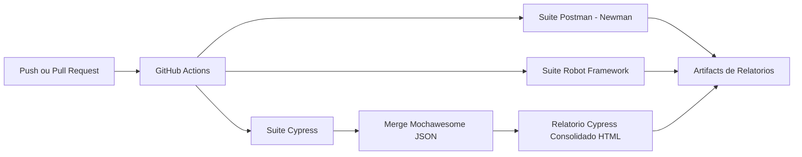

# STEP-QA Framework

Framework de automacao de testes de API em tres camadas:

- Nivel 1: Low-code (Postman + Newman)
- Nivel 2: BDD/Keyword-driven (Robot Framework)
- Nivel 3: Code-first (Cypress)

## Visao Geral

| Nivel | Abordagem | Stack | Objetivo |
|---|---|---|---|
| 1 | Low-code | Postman, Newman | Validacao rapida de colecoes e smoke tests |
| 2 | BDD | Robot Framework, RequestsLibrary | Cenarios legiveis e reaproveitamento de keywords |
| 3 | Code-first | Cypress, Mochawesome | Testes funcionais de interface e de API com JS e relatorio consolidado |

## Arquitetura do Pipeline



## Estrutura de Pastas

```text
step-qa-framework/
├── .github/
│   └── workflows/
│       └── main.yml
├── level-1-postman/
│   ├── collections/
│   │   └── api-tests.postman_collection.json
│   └── environments/
│       └── dev.postman_environment.json
├── level-2-robot/
│   ├── tests/
│   │   ├── tc_01_consultar_pet.robot
│   │   ├── tc_02_pets_disponiveis.robot
│   │   ├── ...
│   │   └── tc_10_endpoint_inexistente.robot
│   ├── resources/
│   │   ├── tc_01_consultar_pet.resource
│   │   ├── tc_02_pets_disponiveis.resource
│   │   ├── ...
│   │   └── tc_10_endpoint_inexistente.resource
│   └── requirements.txt
├── level-3-cypress/
│   ├── cypress/
│   │   ├── e2e/
│   │   │   ├── api/
│   │   │   │   └── petstore.cy.js
│   │   │   └── saucedemo.cy.js
│   │   ├── pages/
│   │   │   ├── login.page.js
│   │   │   ├── inventory.page.js
│   │   │   ├── cart.page.js
│   │   │   └── checkout.page.js
│   │   └── support/
│   │       └── commands.js
│   ├── cypress.config.js
│   └── package.json
├── reports/
│   ├── postman/
│   ├── robot/
│   └── cypress/
├── .gitignore
└── README.md
```

## Sites e Casos de Teste

- Petstore (`https://petstore.swagger.io/v2`): testes de API no Postman/Newman, Robot Framework e Cypress.
- SauceDemo (`https://www.saucedemo.com`): testes automatizados de interface no Cypress.
- Casos manuais: `level-1-postman/manual-test-cases.md`.

Os casos de API podem ser executados manualmente no Postman pela colecao `level-1-postman/collections/api-tests.postman_collection.json` ou automaticamente com Newman.

### Cobertura Postman e Newman

A colecao Petstore cobre listagem e consulta por GET, criacao por POST, atualizacao por PUT e por POST com formulario, e exclusao por DELETE. Consultas posteriores conferem as alteracoes e a exclusao, alem do cenario de consulta a um ID inexistente.

Selecione o ambiente `level-1-postman/environments/dev.postman_environment.json` e execute a colecao na ordem definida: a criacao gera um ID e o salva em `petId` para os passos seguintes; a consulta apos a exclusao limpa a variavel. Os testes usam uma API publica compartilhada; se a execucao for interrompida, exclua o pet de teste criado antes de iniciar novamente. Os passos detalhados estao em `level-1-postman/manual-test-cases.md`.

```bash
newman run level-1-postman/collections/api-tests.postman_collection.json -e level-1-postman/environments/dev.postman_environment.json
```

### Cobertura Robot Framework

A suite automatizada do Robot possui 10 casos de API contra o Petstore. Cada TC esta separado em dois arquivos: o `.resource` contem a chamada HTTP individual e o `.robot` contem as validacoes do caso.

| Tipo | Casos cobertos |
|---|---|
| Positivos | Consulta de pet por ID, listagem de pets disponiveis, listagem de pets vendidos, busca por tag e consulta do inventario da loja |
| Negativos | Pet inexistente, ID de pet invalido, usuario inexistente, pedido inexistente e endpoint inexistente |

Resultado da ultima execucao: **10 testes aprovados e 0 falhas**.

Como o Petstore publico e um ambiente compartilhado, o TC01 cria o pet via POST antes de consulta-lo, garantindo que o cenario nao dependa de dados pre-existentes.

Para executar um unico TC:

```bash
robot -d reports/robot -t "TC01 - Consultar pet por ID" level-2-robot/tests/tc_01_consultar_pet.robot
```

Para executar todos os TCs:

```bash
robot -d reports/robot level-2-robot/tests
```

### Page Object e Cobertura Cypress

O Cypress segue o padrao Page Object: seletores e acoes ficam separados nos objetos de Login, Produtos, Carrinho e Checkout. O spec concentra os cenarios e as validacoes.

A suite de interface automatiza 7 fluxos do SauceDemo:

- Acesso a pagina de produtos.
- Adicao de um produto ao carrinho.
- Adicao de dois produtos ao carrinho.
- Remocao de produto do carrinho.
- Retorno do carrinho para continuar comprando.
- Validacao de checkout sem dados obrigatorios.
- Checkout completo ate a confirmacao do pedido.

### Cobertura de API no Cypress

Alem dos testes de interface, o Cypress executa testes de API com `cy.request()` no spec `cypress/e2e/api/petstore.cy.js`. As chamadas HTTP usam os comandos customizados `cy.apiGet()` e `cy.apiPost()` (definidos em `cypress/support/commands.js`), que apontam para a URL base configurada em `env.apiUrl` no `cypress.config.js` e nao interrompem o teste em status 4xx/5xx, permitindo validar cenarios negativos.

A suite espelha os 10 casos de API do Robot Framework contra o Petstore:

| Tipo | Casos cobertos |
|---|---|
| Positivos | Consulta de pet por ID, listagem de pets disponiveis, listagem de pets vendidos, busca por tag e consulta do inventario da loja |
| Negativos | Pet inexistente, ID de pet invalido, usuario inexistente, pedido inexistente e endpoint inexistente |

Como o Petstore publico e um ambiente compartilhado, o TC01 cria o pet via POST antes de consulta-lo, garantindo que o cenario nao dependa de dados pre-existentes.

Para executar apenas os testes de API:

```bash
cd level-3-cypress
npx cypress run --spec "cypress/e2e/api/petstore.cy.js"
```

## Pre-requisitos

- Node.js 20+
- npm 10+
- Python 3.11+
- pip

## Instalacao Guiada (com links oficiais)

Para facilitar o setup inicial, estes sao os links recomendados:

| Ferramenta | Para que serve no projeto | Link oficial |
|---|---|---|
| Postman | Criar e manter collections de teste | [Postman Downloads](https://www.postman.com/downloads/) |
| Node.js + npm | Executar Newman e Cypress | [Node.js Downloads](https://nodejs.org/en/download) |
| Python | Executar Robot Framework | [Python Downloads](https://www.python.org/downloads/) |
| pip | Instalar pacotes Python | [pip Installation](https://pip.pypa.io/en/stable/installation/) |
| Robot Framework | Suite BDD/keyword-driven | [Robot Framework - Installation](https://robotframework.org/robotframework/latest/RobotFrameworkUserGuide.html#installation-instructions) |
| RequestsLibrary | Requisicoes HTTP no Robot | [robotframework-requests (PyPI)](https://pypi.org/project/robotframework-requests/) |
| Cypress | Suite code-first de testes web | [Cypress - Getting Started](https://docs.cypress.io/guides/getting-started/installing-cypress) |
| Newman | Runner CLI para collections Postman | [Newman (npm)](https://www.npmjs.com/package/newman) |
| Newman HTML Extra | Relatorio HTML do Newman | [newman-reporter-htmlextra (npm)](https://www.npmjs.com/package/newman-reporter-htmlextra) |
| Mochawesome | Relatorio do Cypress | [Mochawesome (npm)](https://www.npmjs.com/package/mochawesome) |

### Checklist Rapido de Setup

1. Instale Node.js e Python pelos links acima.
2. Confirme versoes no terminal:

```bash
node -v
npm -v
python --version
pip --version
```

3. Depois siga a execucao local por nivel.

## Execucao Local

### Nivel 1 - Postman/Newman

1. Instale as ferramentas:

```bash
npm install -g newman newman-reporter-htmlextra
```

2. Execute os testes:

```bash
newman run level-1-postman/collections/api-tests.postman_collection.json -e level-1-postman/environments/dev.postman_environment.json -r htmlextra --reporter-htmlextra-export reports/postman/report.html
```

Saida esperada: `reports/postman/report.html`

### Nivel 2 - Robot Framework

1. Instale dependencias:

```bash
pip install -r level-2-robot/requirements.txt
```

Referencia oficial Robot: [Robot Framework - User Guide](https://robotframework.org/robotframework/latest/RobotFrameworkUserGuide.html)

2. Execute os testes:

```bash
robot -d reports/robot level-2-robot/tests/
```

Saidas esperadas em `reports/robot`:

- report.html
- log.html
- output.xml

### Nivel 3 - Cypress

1. Instale dependencias:

```bash
cd level-3-cypress
npm install
```

Referencia oficial Cypress: [Cypress Documentation](https://docs.cypress.io/)

2. Execute os testes:

```bash
npm run test:api
```

3. Gere o relatorio consolidado:

```bash
npm run report:consolidate
```

Saidas esperadas:

- `reports/cypress/report.html`
- `reports/cypress/mochawesome.json`
- `level-3-cypress/cypress/videos`
- `level-3-cypress/cypress/screenshots`

## CI/CD

O workflow em `.github/workflows/main.yml` executa automaticamente em push e pull request na branch main:

1. Setup de Node.js e Python
2. Suite Postman
3. Suite Robot
4. Suite Cypress
5. Consolidacao do relatorio Cypress
6. Upload de artefatos

## Relatorios Unificados

- Postman: `reports/postman/report.html`
- Robot: `reports/robot/report.html` e `reports/robot/log.html`
- Cypress: `reports/cypress/report.html`

## Convencoes Rapidas

- Collections Postman em `level-1-postman/collections`
- Keywords Robot em `level-2-robot/resources`
- Specs Cypress em `level-3-cypress/cypress/e2e`
- Todos os relatorios centralizados em `reports/`
